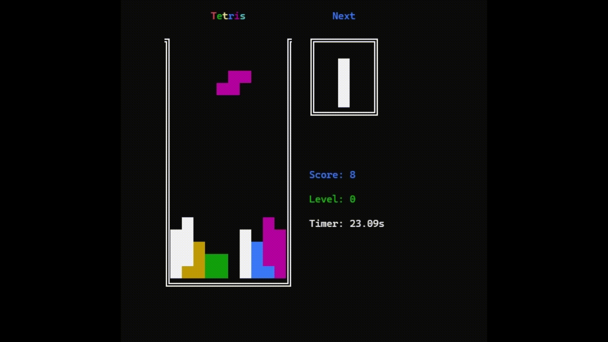

# Tetris – Console Version

Tetris written in plain C (C17) for the Windows console, without any game library. Written in my 2nd year at HTL St. Pölten.



## Features

- All 7 tetrominoes in their own colours, with rotation
- Preview of the next piece
- Three difficulty levels: Easy, Medium, Hard
- Score, level and a timer for the active play time
- Game-over screen with the option to play again

## Controls

| Key | Action |
|---|---|
| ← / → | Move left / right |
| ↑ | Rotate |
| ↓ | Drop faster |
| Esc | End the game |

## Requirements

**Windows only.** The game uses the Windows console (`conio.h`, `windows.h`), code page 437 characters for the borders and blocks, and Windows timing. It does not run correctly on Linux or macOS.

## Build

With CMake (for example in CLion):

```bash
cmake -S . -B build
cmake --build build
build\tetris_optimized.exe
```

Or directly with MinGW:

```bash
gcc -std=c17 main.c console.c tetris.c -o tetris.exe
tetris.exe
```

## Structure

| File | Content |
|---|---|
| `main.c` | Game loop and timing |
| `tetris.c / .h` | Pieces, movement, collision, line clearing, score |
| `console.c / .h` | Console library provided in class (colours, cursor, keyboard input), not my code |